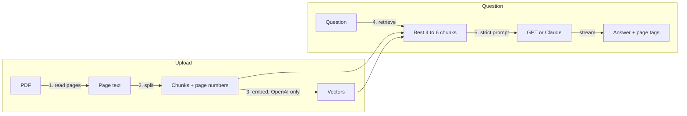

# DocChat: Chat With Your PDF (Next.js 16 + RAG, OpenAI or Claude)

Upload a PDF, ask a question, and get a short answer with the page it came from. If the answer isn't in the document, it says **"I don't know"** instead of making something up.

**[Live demo](https://pdf-chat-ai-neon.vercel.app)** · **[Video tutorial](https://youtu.be/qbC_mh7XlS4)** · MIT license


## Features

- **Answers with sources:** every answer shows the page it came from
- **Honest by design:** says "I don't know" when the document doesn't contain the answer
- **Pick your AI:** OpenAI (embeddings + GPT), Anthropic Claude, or free demo mode with no key
- **Never breaks on AI errors:** if a provider fails (no credits, outage), it falls back to the next one, then to demo mode
- **Streaming answers:** text appears as it's written
- **Secure for a public link:** server-only keys, same-origin API, rate limits, cost caps, strict headers ([details](#security))
- **Stateless:** no database needed, deploys to Vercel in a minute

## Quick start

```bash
git clone https://github.com/osamaayub/pdf-chat-ai.git
cd pdf-chat-ai
npm install
cp .env.example .env.local   # optional: add an OpenAI or Anthropic key
npm run dev
```

Open http://localhost:3000 and upload `sample/brightline-handbook.pdf`, a fictional 4-page handbook made for testing. Try:

- "How many vacation days do I get?" → 25 days (page 2)
- "Who is the CEO's favourite band?" → I don't know

## How it works

RAG (retrieval-augmented generation) means: **find the right parts of the document first, then let the AI answer only from those parts.** That's cheaper than sending the whole PDF and stops the AI from guessing.



| Step | What happens | Code |
| --- | --- | --- |
| 1. Read | Text is pulled from each page with `unpdf`. The file is never saved. | `lib/rag/pipeline.ts` → `readPdf` |
| 2. Chunk | Pages are split into ~800-character pieces that overlap by 150, so no answer is cut in half. Chunks never cross pages. | `lib/rag/chunk.ts` |
| 3. Embed | With OpenAI, each chunk becomes a 256-number vector that captures its meaning. | `lib/ai/openai.ts` → `embed` |
| 4. Retrieve | OpenAI: the 4 chunks closest to the question (cosine similarity). Claude and demo: best keyword matches (BM25). | `lib/rag/search.ts` |
| 5. Answer | Only those chunks go into the prompt, inside `<document>` tags, with the rule "answer only from this". | `lib/rag/prompt.ts`, `lib/rag/pipeline.ts` → `answer` |

### OpenAI, Claude or demo?

| | OpenAI | Claude | Demo (no key) |
| --- | --- | --- | --- |
| Key | `OPENAI_API_KEY` | `ANTHROPIC_API_KEY` | none |
| Search | Embeddings: matches **meaning** | BM25: ranks rare matching **words** | Keyword vectors |
| Answers | `gpt-4.1-mini` | `claude-haiku-5-5` | Quotes the best sentence |
| Cost | Embeddings + answer tokens | Answer tokens only | Free |

Anthropic has no embeddings API, so Claude mode searches with BM25, the classic search-engine ranking, for free. It can miss a question worded differently from the document ("internet" vs "Wi-Fi"); embeddings catch those.

**Which one runs:** `AI_PROVIDER` if you set it, otherwise OpenAI if its key exists, then Claude, then demo. If the chosen provider fails, the app tries the next one and finally answers in demo mode, so users never see a broken page. The badge in the header and the "Search" row under the file show the active mode.

## Architecture

```
src/
├── app/
│   ├── page.tsx                  # page shell + mode badge
│   └── api/
│       ├── upload/route.ts       # thin: guard → validate file → ingest()
│       └── chat/route.ts         # thin: guard → validate body → answer() → stream
├── components/chat.tsx           # upload + chat UI (client), keeps the document in memory
└── lib/
    ├── rag/                      # the RAG logic
    │   ├── pipeline.ts           # ingest() and answer(): the whole flow + provider fallback (server-only)
    │   ├── chunk.ts              # page-aware overlapping chunker (pure)
    │   ├── search.ts             # BM25, cosine, top-k, vector packing (pure)
    │   └── prompt.ts             # system prompt, <document> context, demo answers (pure)
    ├── ai/                       # one file per AI provider, all server-only
    │   ├── config.ts             # which provider, models, cost limits, fallback order
    │   ├── openai.ts             # embed() + streamAnswer()
    │   └── anthropic.ts          # streamAnswer()
    ├── security/
    │   ├── guard.ts              # same-origin check + rate limits for every API route
    │   └── rate-limit.ts         # sliding-window limiter (pure)
    └── http.ts                   # streaming response + JSON error helpers
```

Design rules:

- **Routes are thin.** They check the request and call `ingest()` or `answer()`. All RAG logic lives in `lib/rag`, so it can be tested without HTTP.
- **Pure logic is separate from network code.** `chunk.ts`, `search.ts`, `prompt.ts` and `rate-limit.ts` have no imports from AI SDKs, so tests run instantly and offline.
- **Providers share one shape.** Each returns an async stream of text, so adding another model (Gemini, Mistral) means one new file in `lib/ai` and one line in `config.ts`.
- **No server state.** On Vercel each request can land on a different server, so the upload returns the chunks (and packed vectors) and the browser sends them back with each question. For saved documents and many users, move them to Postgres with pgvector.

## Security

| Risk | Protection |
| --- | --- |
| API key leaking | Keys are read only in `lib/ai`, marked `server-only`, so the build fails if they reach browser code |
| Other sites using your API | Same-origin check on every API route |
| Someone running up your bill | Per-IP rate limits (10 uploads/hour, 30 questions/10 min), `max_tokens: 500`, 4 MB / 120 pages / 400 chunks caps |
| Fake or harmful files | Checks the real `%PDF-` signature; files are never stored |
| Bad input | Every request body validated with Zod, with size limits on each field |
| Prompt injection in the PDF | Document wrapped in `<document>` tags; the prompt says to treat it as data, not instructions |
| XSS, clickjacking, sniffing | Strict Content-Security-Policy, `frame-ancestors 'none'`, `nosniff`, HSTS |
| Leaking errors | Generic messages to users; details only in server logs |

The rate limiter lives in each server's memory, so on Vercel it's a speed bump, not a wall. For a strict shared limit, swap the `Map` for Redis (for example Upstash) behind the same function. **Always set a monthly budget with your AI provider** before putting a key on a public site: that's the one limit code can't bypass.

## Deploy on Vercel

1. Push this repo to your GitHub.
2. On [vercel.com/new](https://vercel.com/new), import it. Vercel detects Next.js; keep the defaults.
3. Under **Environment Variables**, add `OPENAI_API_KEY` or `ANTHROPIC_API_KEY` as a **Secret**. Add neither for free demo mode.
4. Click **Deploy**. After changing a variable later, redeploy so it takes effect.
5. Set a monthly spending limit with your AI provider.

## Environment variables

| Variable | Default | What it does |
| --- | --- | --- |
| `OPENAI_API_KEY` | | Embeddings search + GPT answers |
| `ANTHROPIC_API_KEY` | | BM25 search + Claude answers |
| `AI_PROVIDER` | auto | Force `openai`, `anthropic` or `demo` (used only if that key exists) |
| `OPENAI_MODEL` | `gpt-4.1-mini` | OpenAI chat model |
| `OPENAI_EMBEDDING_MODEL` | `text-embedding-3-small` | OpenAI embedding model |
| `CLAUDE_MODEL` | `claude-haiku-5-5` | Claude model |

## Scripts

| Command | What it does |
| --- | --- |
| `npm run dev` | Development server |
| `npm test` | Vitest: chunking, overlap, page tags, "I don't know", BM25, vector packing, rate limits, prompt wrapping, provider selection and fallback |
| `npm run typecheck` | TypeScript check |
| `npm run build` | Production build |

## Limits and next steps

- Scanned PDFs are images with no text. Add OCR to support them.
- One PDF at a time, kept in the browser tab. Add login + Postgres/pgvector to save documents.
- Try these as practice: chat with two PDFs at once, highlight the source sentence, add a "copy answer with sources" button.

## Stack

Next.js 16 (App Router, Route Handlers), React 19, TypeScript, Tailwind CSS 4, OpenAI SDK, Anthropic SDK, unpdf, Zod, Vitest.

## Author

Built by [Osama Ayub](https://github.com/osamaayub), full-stack developer (React, Next.js, Node.js, AI integration). Need an AI chatbot in your product? [Hire me on Upwork](https://www.upwork.com/freelancers/~01c0c3cf471b66a427).

## License

MIT
