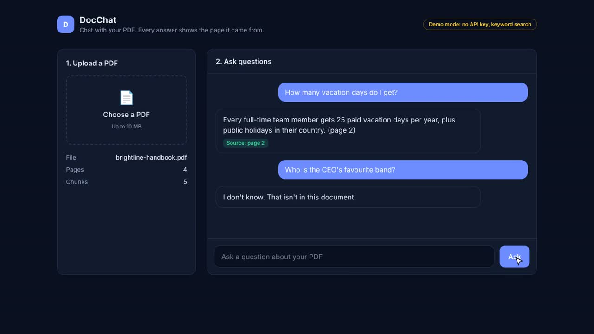
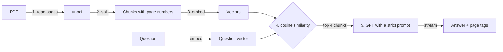

# DocChat: AI PDF Chatbot (Next.js 16 + OpenAI, RAG)

Upload a PDF, ask questions, and get short answers with the page they came from. If the answer is not in the document, it says so instead of making something up.

**Live demo:** [pdf-chat-ai-neon.vercel.app](https://pdf-chat-ai-neon.vercel.app) · **Video tutorial:** [Build an AI PDF Chatbot with Next.js and OpenAI](https://www.youtube.com/@osamaayubdev)



## Features

- Upload a PDF (up to 4 MB, 120 pages) and chat with it
- Answers stream in word by word, with **source page tags**
- Says **"I don't know"** when the answer isn't in the document
- OpenAI embeddings (`text-embedding-3-small`) and `gpt-4.1-mini`
- **Free demo mode**: runs without an API key (keyword search, quoted answers)
- Security built in: same-origin API, rate limits, strict headers, cost caps (see [Security](#security))
- Stateless, so it deploys on Vercel with zero setup

## How it works (RAG in 5 steps)



1. **Read** the PDF page by page with `unpdf`. The file is never saved.
2. **Split** each page into ~800-character chunks with 150 characters of overlap. Chunks never cross pages, so each one knows its page.
3. **Embed** every chunk once, at upload, with OpenAI (256 dimensions to keep them small).
4. **Retrieve** the 4 chunks closest to the question by cosine similarity.
5. **Answer** with `gpt-4.1-mini` at temperature 0, using only those chunks, and stream the answer back.

## Architecture

```
Browser (React client)                     Server (Next.js route handlers)
┌─────────────────────────┐   POST file    ┌──────────────────────────────┐
│ components/chat.tsx     │ ─────────────▶ │ api/upload: guard → read →   │
│ keeps chunks + vectors  │ ◀───────────── │ chunk → embed (OpenAI)       │
│ for the open document   │  chunks+vectors└──────────────────────────────┘
│                         │   POST question┌──────────────────────────────┐
│                         │ ─────────────▶ │ api/chat: guard → validate → │
│ renders streamed answer │ ◀───────────── │ retrieve → GPT → stream      │
└─────────────────────────┘  text stream   └──────────────────────────────┘
                                                OPENAI_API_KEY lives here only
```

**Why the browser holds the document:** on Vercel every request can land on a different server, so server memory is not shared between requests. Instead of a database, the upload returns the chunks (and packed vectors) and the browser sends them with each question. Nothing is stored on the server. For multi-user apps with saved documents, move this to Postgres with pgvector.

```
src/
├── app/
│   ├── api/upload/route.ts   # 1-3: validate, read, chunk, embed
│   ├── api/chat/route.ts     # 4-5: validate, retrieve, answer, stream
│   ├── layout.tsx, page.tsx
├── components/chat.tsx       # upload + chat UI (client)
└── lib/
    ├── chunk.ts              # page-aware overlapping chunker (pure)
    ├── text.ts               # keyword vectors, cosine similarity (pure)
    ├── store.ts              # pack/unpack vectors, top-k retrieval (pure)
    ├── answer.ts             # system prompt, context builder, demo answers
    ├── vectors.ts            # OpenAI client + embeddings (server-only)
    ├── guard.ts              # same-origin check + rate limits (server-only)
    └── rate-limit.ts         # sliding-window limiter
```

Files marked `server-only` fail the build if they are ever imported into browser code, so the API key can't leak into the client bundle.

## Security

| Risk | What the app does |
| --- | --- |
| API key leaking | Key is read only in `server-only` files and never sent to the browser |
| Other sites using your API | Same-origin check on every API route (`guard.ts`) |
| Someone running up your bill | Rate limits per IP (10 uploads/hour, 30 questions/10 min), `max_tokens: 500`, 4 MB / 120 page / 400 chunk caps |
| Fake or harmful files | Checks the real `%PDF-` file signature, not just the name; files are never saved |
| Bad input | Every request body is validated with Zod; size limits on every field |
| Prompt injection inside the PDF | Document is wrapped in `<document>` tags and the prompt says to treat it as data, not instructions |
| Clickjacking, XSS, sniffing | Strict Content-Security-Policy, `frame-ancestors 'none'`, `nosniff`, HSTS |
| Leaking errors | Generic error messages to users, details only in server logs |

Know the limits: the rate limiter lives in each server instance's memory, so it is a speed bump, not a hard wall. For a strict shared limit, swap it for Redis (for example Upstash) with the same interface. **Always set a monthly budget in your OpenAI account** (Settings → Limits) before you put a key on a public site.

## Run it locally

```bash
git clone https://github.com/osamaayub/pdf-chat-ai.git
cd pdf-chat-ai
npm install
cp .env.example .env.local   # optional: add OPENAI_API_KEY
npm run dev
```

Open http://localhost:3000 and upload `sample/brightline-handbook.pdf` (a fictional 4-page handbook made for testing).

| Command | What it does |
| --- | --- |
| `npm run dev` | Start the dev server |
| `npm test` | Vitest: chunking, overlap, page tags, "I don't know", vector packing, rate limits, prompt wrapping |
| `npm run typecheck` | TypeScript check |
| `npm run build` | Production build |

## Deploy on Vercel

1. Fork or push this repo to your GitHub.
2. On [vercel.com/new](https://vercel.com/new), import the repo. Vercel detects Next.js; keep the defaults.
3. Under **Environment Variables**, add `OPENAI_API_KEY` (mark it Sensitive). Skip it to deploy in free demo mode.
4. Click **Deploy**. Every push to `main` deploys again.
5. Set a monthly budget in your OpenAI account.

| Variable | Required | What it does |
| --- | --- | --- |
| `OPENAI_API_KEY` | No | Real embeddings and GPT answers. Without it the app runs in demo mode. |

### Demo mode

Without a key the app uses a keyword vector instead of embeddings and quotes the best matching sentence instead of calling a model. It's free, but it matches words, not meaning: "Does the studio pay for internet?" picks a co-working sentence because it shares "studio" and "pay". Embeddings fix that.

## Next steps (try these yourself)

- Save documents per user with auth and Postgres + pgvector
- Chat with several PDFs at once
- Highlight the exact source sentence on the page
- OCR for scanned PDFs

## Stack

Next.js 16 (App Router, Route Handlers), React 19, TypeScript, Tailwind CSS 4, OpenAI SDK, unpdf, Zod, Vitest.

## Author

Built by [Osama Ayub](https://github.com/osamaayub), full-stack developer (React, Next.js, Node.js, AI integration). Need an AI chatbot in your product? [Hire me on Upwork](https://www.upwork.com/freelancers/~01c0c3cf471b66a427).

## License

MIT
